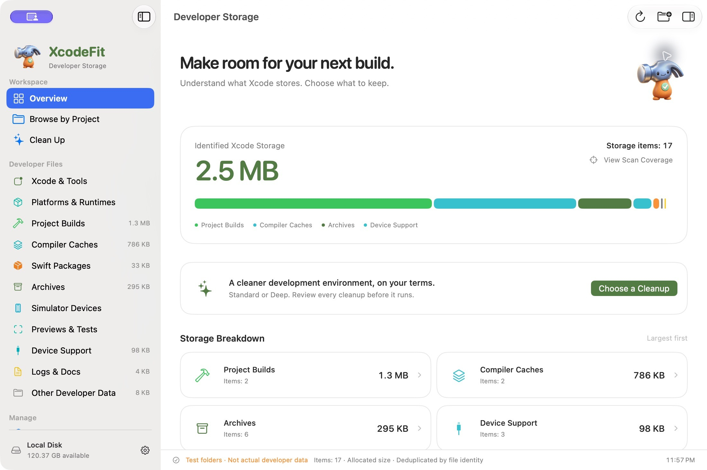
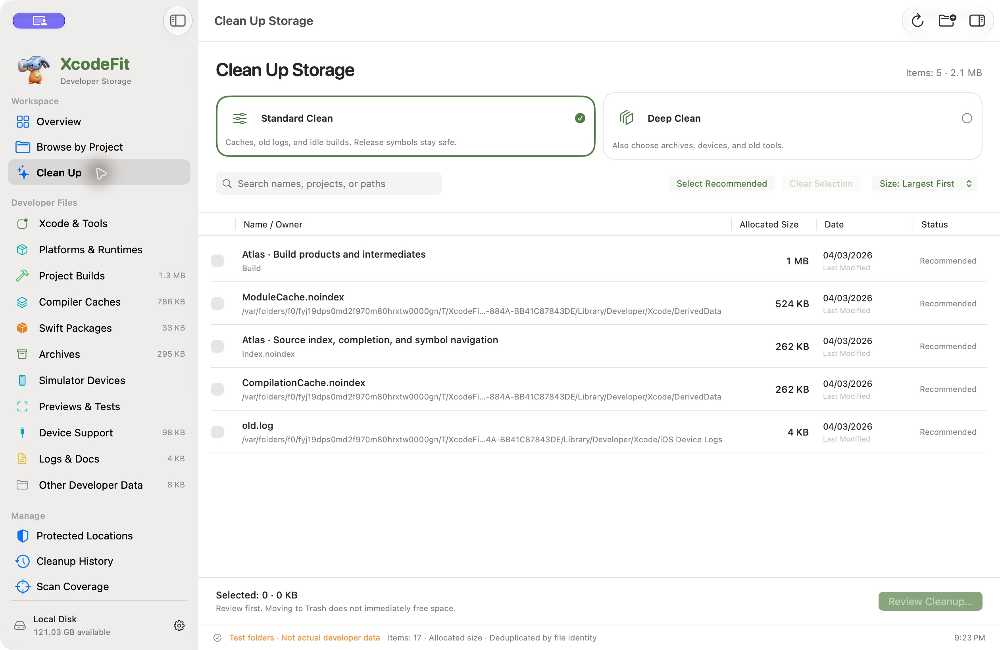

<p align="center">
  
</p>
<h1 align="center">XcodeFit</h1>
<p align="center"><strong>A little fitter. A lighter Xcode.</strong></p>
<p align="center">Understand what Xcode stores. Choose what to keep.</p>
<p align="center">
  <a href="https://xnu.app/xcodefit/">Website</a> ·
  <a href="https://github.com/everettjf/homebrew-tap/releases?q=xcodefit&amp;expanded=true">Download</a> ·
  <a href="CHANGELOG.md">Changelog</a> ·
  <a href="CONTRIBUTING.md">Contribute</a>
</p>
<p align="center">
  
  <a href="LICENSE"></a>
</p>

<picture>
  <source media="(prefers-color-scheme: dark)" srcset="web/assets/screenshots/overview-dark.jpg">
  <source media="(prefers-color-scheme: light)" srcset="web/assets/screenshots/overview-light.jpg">
  
</picture>

<p align="center"><sub>Real native interface, shown with isolated test folders. Screenshot follows light/dark appearance; example sizes are not cleanup results.</sub></p>

XcodeFit is a free, open-source macOS app for browsing and cleaning Xcode-related storage. See where space goes, learn what each folder does, protect what matters, and review every cleanup before it runs.

Built with **SwiftUI, AppKit, and Foundation**. No third-party runtime dependencies.

## Install

```sh
brew install --cask everettjf/tap/xcodefit
```

Or [download the signed and notarized app](https://github.com/everettjf/homebrew-tap/releases?q=xcodefit&expanded=true). Requires **macOS 14+**. **Apple Silicon is the primary platform.**

| Package | Contents and scope |
| --- | --- |
| **Apple Silicon** | `arm64` only. Primary package; selected automatically by Homebrew on Apple Silicon. |
| **Universal** | `arm64` + `x86_64`. Optional download; **Intel execution is untested**. Architecture coverage is not a claim of verified compatibility. |

To upgrade:

```sh
brew update
brew upgrade --cask xcodefit
```

Already using XcodeSize? Follow the [migration guide](docs/UPGRADING.md) to carry over your preferences, protected locations, and cleanup history.

## What you can do

- **See the whole picture.** Browse recognized Xcode installations, tools, project builds, caches, Swift packages, archives, simulators, runtimes, device support, previews, logs, and documentation.
- **Understand each folder.** Inspect its purpose, project or app ownership, path, size, and cleanup impact. Browse contents or reveal an item in Finder.
- **Look by project.** Find related build data and archives, including recognized custom locations. Add your own scan roots.
- **Keep what matters.** Protect locations and their descendants. Review archive retention by application, platform, and signing team.
- **Check release symbols.** See product and dSYM sizes, and check binary/symbol UUID matches without assuming that a backup exists.
- **Feel at home on macOS.** Native system surfaces follow light/dark appearance, with bamboo-green accents. English, 简体中文, 繁體中文, 日本語, and 한국어 are included.

## Two cleanup modes

| | Standard Clean · default | Deep Clean |
| --- | --- | --- |
| Scope | Regenerable compiler caches, old logs, and idle build/index data | Adds explicit choices for archives, source dependencies, device support, simulators, runtimes, and inactive Xcode installations |
| Release archives & symbols | Excluded; build folders containing dSYMs are also excluded | Select manually, or preview keeping the latest 1, 3, or 5 versions with every build |
| Device & local test state | Excluded | Explicit choice, with an additional acknowledgment for irreversible simulator removal |
| Before cleanup | Review the exact selection | Review the exact selection |

<picture>
  <source media="(prefers-color-scheme: dark)" srcset="web/assets/screenshots/cleanup-dark.jpg">
  <source media="(prefers-color-scheme: light)" srcset="web/assets/screenshots/cleanup-light.jpg">
  
</picture>

<sub>Cleanup screen with isolated test folders. Choosing a mode does not execute cleanup.</sub>

**Ordinary files move to Trash.** A failed move never falls back to permanent deletion. Supported simulator removals use Apple’s `simctl` and cannot be recovered from Trash. The app never empties Trash or forcibly quits development tools.

Protected, incomplete, changed, or ineligible locations are skipped. Unknown archives stay under version-retention rules. Every distributed build needs its own matching dSYMs, even if a newer release exists.

See [storage coverage, cleanup rules, and measurement details](docs/STORAGE.md). Identified size is **not** a promise of reclaimed space; APFS shared blocks, snapshots, and Trash affect the result. Arbitrary custom output paths may need to be added manually.

## Stay up to date

Open **XcodeFit → Check for Updates…** or **Settings → Software Updates**. Automatic checks run at launch or when returning to the app, at most once a day, and can be disabled. A newer release appears in the sidebar with a download link and Homebrew instructions.

Scanning and cleanup run locally. Update checks request public release metadata from GitHub; no file data is sent, and updates are never installed automatically.

## Build and test

Open `XcodeFit/XcodeFit.xcodeproj`, choose the **XcodeFit** scheme, and run on **My Mac**. Or build an unsigned development app from the repository root:

```sh
xcodebuild -project XcodeFit/XcodeFit.xcodeproj -scheme XcodeFit \
  -configuration Debug -destination 'platform=macOS' \
  -derivedDataPath build CODE_SIGNING_ALLOWED=NO build

swift test
python3 Tools/ValidateLocalizations.py
```

Use isolated sample folders when exploring the UI:

```sh
open build/Build/Products/Debug/XcodeFit.app --args --ui-fixture
```

Intel execution and the oldest supported macOS version have not been verified on hardware.

Source builds require the installed Xcode and SDK to support this project. Packaging does not run runtime tests by default.

More: [development, localization, release, and website guide](docs/DEVELOPMENT.md).

## Contributing

Bug reports, translations, documentation, and focused pull requests are welcome. Start with the [contribution guide](CONTRIBUTING.md), or [open an issue](https://github.com/everettjf/xcodefit/issues).

For scanning or cleanup changes, describe the path you are handling, how it is classified, and what happens when it is protected, unreadable, active, or changed during a scan. Use disposable fixtures to verify behavior.

## License

[Apache License 2.0](LICENSE). See [NOTICE](NOTICE) for attribution. The mascot is original XcodeFit artwork made with AI assistance; its provenance is recorded in [Brand](Brand/README.md).

XcodeFit is an independent project and is not affiliated with Apple.
